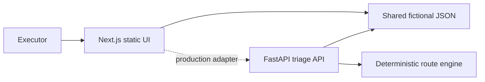

# Architecture

The deployed GitHub Pages artifact is static and computes the same transparent rules as the FastAPI domain operation. The API is tested source only. A production adapter would send item facts and consent signals to FastAPI, persist decision events, and reject stale updates with version checks.

Failure paths: invalid timeline is inline; unknown items return 404; missing/malformed fixtures return 503; empty filtered queues retain guidance; future upstream image failures must preserve manual entry and never default to disposal. Metrics should cover completion, abstention, reversals, time-to-route, false-negative escalations, and provider outcomes.
